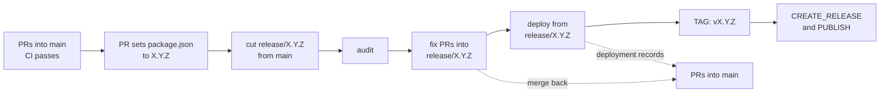

# Release Flow

This flow covers every 1inch contract repository: solidity-utils, aqua, swap-vm, limit-order-protocol, fusion-protocol and cross-chain-swap. A repository that deploys nothing, such as solidity-utils, skips the deploy and the deployment records; every other step is the same.

Contracts are immutable and every version is a fresh deploy, so: **one release branch == one audit == one deploy == one tag.**

## Branches

**`main`** — development. All work lands via pull requests, and CI tests each of them before the merge. Work on the next version goes on here while a release branch is in audit.

**`release/X.Y.Z`** — one per version, cut from a commit on `main` whose `package.json` already says `X.Y.Z`, or, for a patch, from the tag of the version it fixes. Until the tag, the branch takes only this release's fixes, through pull requests; a patch branch also takes its version bump. The cut goes to audit, the fixes go to the auditor's fix review, and the head of the branch is what gets deployed and tagged. After the tag the branch never changes.

*A problem found before the tag, by the audit or otherwise, is fixed in `release/X.Y.Z` through a pull request and reaches `main` when the branch is merged back. A problem found after the tag is fixed in a patch, `X.Y.(Z+1)`, on a release branch cut from the tag `vX.Y.Z`, so the patch carries no unaudited work from `main`.*

| Prefix                              | Purpose                                                 | Example                          |
|-------------------------------------|---------------------------------------------------------|----------------------------------|
| `release/X.Y.Z`                     | One release: audited, fixed, deployed and tagged        | `release/1.0.1`                  |
| `feat/<topic>`                      | Feature, targets `main`                                 | `feat/lp-rewards`                |
| `fix/<topic>`                       | Bug fix, targets `main`, or the release branch it fixes | `fix/rounding-error`             |
| `audit-<auditor>-<finding>/<topic>` | Audit remediation, targets the audited release branch   | `audit-oz-3/reentrancy-on-claim` |
| `merge/release-X.Y.Z`               | Brings `release/X.Y.Z` back into `main`                 | `merge/release-1.0.0`            |

*Auditor and finding id in the branch name point back to the report; the finding text goes in the PR description.*

## Versioning

SemVer `vMAJOR.MINOR.PATCH`:

| Bump  | Meaning                                                      |
|-------|--------------------------------------------------------------|
| MAJOR | ABI or storage-layout break                                  |
| MINOR | Backwards-compatible addition                                |
| PATCH | Bug or security fix, no externally observable change         |

A release branch is cut from `main` for a new version, or from the tag of a deployed version for its patch. The pull request that prepares a release sets `package.json` to `X.Y.Z`: into `main` before the cut, or as the first pull request into a patch branch. No other pull request changes the version, and a merge back into `main` keeps the version `main` has.

## Lifecycle



1. Prepare: merge the pull request that sets `package.json` to `X.Y.Z` into `main`, and wait for CI to pass on the merge commit.
2. Cut: create `release/X.Y.Z` from that commit. This is what goes to audit.
3. Fix: findings and other bugs of this release are fixed through pull requests into `release/X.Y.Z`, and the auditor reviews the fixes. Work on the next version goes on in `main`.
4. Deploy from the head of `release/X.Y.Z`, where the repository deploys contracts, and bring `deployments/<chain>/vX.Y.Z.json` into `main` through a pull request.
5. Tag: run `TAG` from `release/X.Y.Z` once CI has passed on its head. The branch takes no change after that.
6. Run `CREATE_RELEASE` and `PUBLISH` from the tag.
7. Merge back: bring `release/X.Y.Z` into `main` through a pull request, at the latest after the tag; see [Merge back](#merge-back).

A patch of a deployed version starts from its tag: cut `release/X.Y.(Z+1)` from `vX.Y.Z` and set `package.json` to `X.Y.(Z+1)` in its first pull request. Then the patch goes to audit and through steps 3 to 7 like any release.

## Deployment records

Each deploy records `deployments/<chain>/vX.Y.Z.json`: addresses, tx hashes, block numbers, git SHA, deployer, toolchain version, verification metadata. The records reach `main` through a pull request and are not committed to the release branch, so its head, and the tag on it, stays the deployed commit.

## Tags

`release/X.Y.Z` produces exactly one tag `vX.Y.Z`, created by the `TAG` workflow, which a maintainer runs by hand from the release branch: after the deploy, or, where nothing is deployed, once the release takes no more fixes. It takes the version from `package.json` on the release branch, refuses to run from any branch other than `release/<that version>`, and refuses a head whose CI run from a push, to `main` or to the release branch, has not passed. After the tag the release branch takes no change. Tags are never moved or deleted; a mistake means a new release.

## Merge back

A release branch reaches `main` through a pull request from `merge/release-X.Y.Z`, a branch cut from `main` with `release/X.Y.Z` merged into it. Conflicts are resolved on that branch, and the release branch stays as it is. On a `package.json` conflict, keep the version `main` has.

The pull request is merged with a merge commit, not a squash, so the release's commits stay in `main`'s history and the next merge back of the same branch does not conflict with them. Merging back as the fixes land keeps `main` from building on the bugs; after the tag it is required.

## Workflows

Every repository runs the same workflows, which call the shared ones in this repository; see the [README](README.md):

- `CI` on every pull request and on pushes to `main` and `release/*`.
- `TAG`, then `CREATE_RELEASE` from the tag, which creates the GitHub Release.
- `PUBLISH` from the tag, which publishes the npm package.

## Rules

1. `main` and `release/*` accept only PRs, merged once CI passes.
2. Work branches are cut from `main` and target `main`; a change for a release that is not tagged yet is cut from its release branch and targets it.
3. `release/X.Y.Z` is cut from a commit on `main` whose `package.json` says `X.Y.Z`, or from the tag of the version it patches. It takes only this release's fixes, plus a patch's version bump, and no change after its tag.
4. Every release branch is merged back into `main` with a merge commit, at the latest after its tag.
5. One production deploy per release branch; another deploy is a new release.
6. Every production deploy is audited, patches included; the fixes on a release branch go to the auditor's fix review.
7. Deployment records reach `main` through a PR; tags are created by CI, never moved or deleted.
8. `main`, `release/*` and `v*` tags are protected: no force-push, no deletion, and `release/*` takes no change after its tag.

## Commands

```bash
# cut a release once the version PR is merged and CI has passed on main
git fetch origin && git checkout -b release/1.0.0 origin/main && git push -u origin release/1.0.0

# fix for an audit finding in release/1.0.0
git checkout -b audit-oz-3/reentrancy-on-claim origin/release/1.0.0   # PR into release/1.0.0

# merge release/1.0.0 back into main
git fetch origin && git checkout -b merge/release-1.0.0 origin/main
git merge --no-ff origin/release/1.0.0   # on a package.json conflict, keep the version main has
git push -u origin merge/release-1.0.0   # PR into main, merged with a merge commit

# patch the deployed v1.0.0 as 1.0.1
git fetch origin && git checkout -b release/1.0.1 v1.0.0 && git push -u origin release/1.0.1   # first PR sets package.json to 1.0.1
```

## Planned: deploys from GitHub Releases

Deploys run in GitHub Actions triggered by GitHub Releases. Requirements: hermetic builds (pinned toolchain, lockfiles, no network) so `git checkout vX.Y.Z && build` reproduces on-chain bytes; a draft Release on the release branch triggers the deploy and the tag, and the deployment records reach `main` through a pull request; a mainnet environment with required reviewers so a deploy needs approval.
