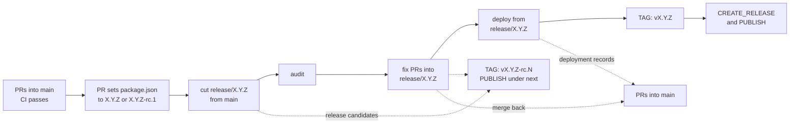

# Release Flow

This flow covers every 1inch contract repository: solidity-utils, aqua, swap-vm, limit-order-protocol, fusion-protocol and cross-chain-swap. A repository that deploys nothing, such as solidity-utils, skips the deploy and the deployment records. A release that [changes no contract](#versioning) skips the audit, the deploy and the deployment records. Every other step is the same.

Contracts are immutable and every contract change is a fresh deploy, so: **one release branch == one audit == one deploy == one release tag.** Before its release tag, a release branch can tag [release candidates](#release-candidates), which put the package on npm before its audit is done.

## Branches

**`main`** — development. All work lands via pull requests, and CI tests each of them before the merge. Work on the next version goes on here while a release branch is in audit.

**`release/X.Y.Z`** — one per version, cut from a commit on `main` whose `package.json` already says `X.Y.Z`, or `X.Y.Z-rc.1` where the release starts with a release candidate, or, for a patch, from the tag of the version it fixes. Until the release tag, the branch takes only this release's changes, through pull requests, and once its audit has started, only fixes and version bumps. The audit covers the cut or one of the release candidates, the fixes after it go to the auditor's fix review, and the head of the branch is what gets deployed and tagged. After the release tag the branch never changes.

*A problem found before the release tag, in a release candidate, by the audit or otherwise, is fixed in `release/X.Y.Z` through a pull request and reaches `main` when the branch is merged back. A problem found after the release tag is fixed in a patch, `X.Y.(Z+1)`, on a release branch cut from the tag `vX.Y.Z`, so the patch carries no unaudited work from `main`.*

| Prefix                              | Purpose                                                                     | Example                          |
|-------------------------------------|-----------------------------------------------------------------------------|----------------------------------|
| `release/X.Y.Z`                     | One release and its release candidates: audited, fixed, deployed and tagged | `release/1.0.1`                  |
| `feat/<topic>`                      | Feature, targets `main`, or a release branch before its audit               | `feat/lp-rewards`                |
| `fix/<topic>`                       | Bug fix, targets `main`, or the release branch it fixes                     | `fix/rounding-error`             |
| `audit-<auditor>-<finding>/<topic>` | Audit remediation, targets the audited release branch                       | `audit-oz-3/reentrancy-on-claim` |
| `merge/release-X.Y.Z`               | Brings `release/X.Y.Z` back into `main`                                     | `merge/release-1.0.0`            |

*Auditor and finding id in the branch name point back to the report; the finding text goes in the PR description.*

## Versioning

SemVer `vMAJOR.MINOR.PATCH`, and `vMAJOR.MINOR.PATCH-rc.N` for a [release candidate](#release-candidates):

| Bump  | Meaning                                                      |
|-------|--------------------------------------------------------------|
| MAJOR | ABI or storage-layout break                                  |
| MINOR | Backwards-compatible addition                                |
| PATCH | Bug or security fix, no externally observable change         |

A release changes no contract when its contracts compile to the same bytecode as those of the version before it, as when only tests, scripts or TypeScript change. It bumps PATCH, needs no audit and deploys nothing. A change to a contract's source, to a dependency compiled into it, such as solidity-utils or OpenZeppelin, or to the compiler settings changes the bytecode: the release goes to audit, and its packages are release candidates until the audit is done.

A release branch is cut from `main` for a new version, or from the tag of a deployed version for its patch. The pull request that prepares a release sets `package.json` to `X.Y.Z`, or to `X.Y.Z-rc.1` where the release starts with a release candidate: into `main` before the cut, or as the first pull request into a patch branch. After it, only pull requests into the release branch change the version, each to the next release candidate or to `X.Y.Z`. A merge back into `main` resolves a `package.json` conflict to the version `main` has.

## Lifecycle



1. Prepare: merge the pull request that sets `package.json` to `X.Y.Z`, or to `X.Y.Z-rc.1` for [release candidates](#release-candidates), into `main`, and wait for CI to pass on the merge commit.
2. Cut: create `release/X.Y.Z` from that commit. This is what goes to audit, unless a later release candidate does.
3. Fix: findings and other bugs of this release are fixed through pull requests into `release/X.Y.Z`, and the auditor reviews the fixes. Work on the next version goes on in `main`.
4. Deploy from the head of `release/X.Y.Z` once its `package.json` says `X.Y.Z`, where the repository deploys contracts, and bring `deployments/<chain>/vX.Y.Z.json` into `main` through a pull request.
5. Tag: run `TAG` from `release/X.Y.Z` once CI has passed on its head. The branch takes no change after that.
6. Run `CREATE_RELEASE` and `PUBLISH` from the tag.
7. Merge back: bring `release/X.Y.Z` into `main` through a pull request, at the latest after the tag; see [Merge back](#merge-back).

A patch of a deployed version starts from its tag: cut `release/X.Y.(Z+1)` from `vX.Y.Z` and set `package.json` to `X.Y.(Z+1)`, or `X.Y.(Z+1)-rc.1`, in its first pull request. Then the patch goes to audit, if it changes a contract, and through steps 3 to 7 like any release.

To bring an existing branch into this flow, create `release/X.Y.Z` from its head, where its `package.json` says `X.Y.Z` or `X.Y.Z-rc.N`. Open a pull request that adds the current CI, TAG, CREATE_RELEASE and PUBLISH callers. Merge that pull request into the release branch before tagging.

## Release candidates

A release that changes a contract can publish its package before its audit is done, as a release candidate `X.Y.Z-rc.N`, so that the repositories that build on it, as swap-vm builds on aqua, have an npm version to depend on. Every release candidate of `X.Y.Z` comes from `release/X.Y.Z`, the branch of the release, and has a tag of its own, `vX.Y.Z-rc.N`:

1. Prepare and cut the release as in [Lifecycle](#lifecycle), with `package.json` set to `X.Y.Z-rc.1`.
2. Run `TAG` from `release/X.Y.Z` once CI has passed on its head, then `CREATE_RELEASE` and `PUBLISH` from the tag. The GitHub Release is a pre-release, and npm takes the package under the `next` dist-tag, so `latest` stays on the last release.
3. The next release candidate is a pull request into `release/X.Y.Z` that sets `package.json` to `X.Y.Z-rc.(N+1)` once the changes it carries have landed. It is tagged and published as in step 2.
4. Once the auditor has reviewed the fixes, a pull request sets `package.json` to `X.Y.Z`, and the release goes through steps 4 to 7 of [Lifecycle](#lifecycle).

Publishing `X.Y.Z` makes it `latest`, but leaves `next` on the last release candidate, which is then older than `latest`. Where the `PUBLISH` caller sets `move-next`, the npm job moves `next` to the release; elsewhere, or where the job prints the command instead, a package admin runs `npm dist-tag add <package>@X.Y.Z next`. See the [README](README.md#npm).

Until the audit starts, the branch takes the rest of the release's work as well as its fixes; from then on it takes only fixes and version bumps. The audit covers one release candidate, which the report names by its tag, and the fixes after it go to the auditor's fix review. A release candidate is never deployed to production.

A repository that builds on a release candidate pins its exact version, such as `"@1inch/aqua": "1.0.2-rc.1"`, because a range such as `^1.0.2-rc.1` also takes the later release candidates. A release depends on no release candidate: before its own release, a repository moves such a dependency to a release.

## Deployment records

Each deploy records `deployments/<chain>/vX.Y.Z.json`: addresses, tx hashes, block numbers, git SHA, deployer, toolchain version, verification metadata. The records reach `main` through a pull request and are not committed to the release branch, so its head, and the tag on it, stays the deployed commit.

## Tags

`release/X.Y.Z` produces exactly one release tag `vX.Y.Z`, and before it a tag `vX.Y.Z-rc.N` for each release candidate. The `TAG` workflow creates them, and a maintainer runs it by hand from the release branch: for a release candidate, when its package is needed; for the release, after the deploy, or, where nothing is deployed, once the release takes no more fixes. It takes the version from `package.json` on the release branch, refuses a version other than `X.Y.Z` or `X.Y.Z-rc.N`, refuses to run from any branch other than `release/X.Y.Z`, and refuses a head whose CI run from a push, to `main` or to the release branch, has not passed. After the release tag the release branch takes no change. Tags are never moved or deleted; a mistake means a new release, or a new release candidate.

## Merge back

A release branch reaches `main` through a pull request from `merge/release-X.Y.Z`, a branch cut from `main` with `release/X.Y.Z` merged into it. Conflicts are resolved on that branch, and the release branch stays as it is. On a `package.json` conflict, keep the version `main` has.

The pull request is merged with a merge commit, not a squash, so the release's commits stay in `main`'s history and the next merge back of the same branch does not conflict with them. Merging back as the changes land keeps `main` from building on the bugs; after the release tag it is required.

## Workflows

Every repository runs the same workflows, which call the shared ones in this repository; see the [README](README.md):

- `CI` on every pull request and on pushes to `main` and `release/*`.
- `TAG`, then `CREATE_RELEASE` from the tag, which creates the GitHub Release, a pre-release for a release candidate.
- `PUBLISH` from the tag, which publishes the npm package, under the `next` dist-tag for a release candidate.

## Rules

1. `main` and `release/*` accept only PRs, merged once CI passes.
2. Work branches are cut from `main` and target `main`; a change for a release that has no release tag yet is cut from its release branch and targets it.
3. `release/X.Y.Z` is cut from a commit on `main` whose `package.json` says `X.Y.Z` or `X.Y.Z-rc.1`, or from the tag of the version it patches. It takes only this release's changes, only fixes and version bumps once its audit has started, and no change after its release tag.
4. Every release branch is merged back into `main` with a merge commit, at the latest after its release tag.
5. One production deploy per release branch, and none of a release candidate; another deploy is a new release.
6. Every release that changes a contract is audited, patches included; the fixes on its branch after the audited commit go to the auditor's fix review. Until the audit is done, its packages are release candidates.
7. Deployment records reach `main` through a PR; tags are created by CI, never moved or deleted.
8. `main`, `release/*` and `v*` tags are protected: no force-push, no deletion, and `release/*` takes no change after its release tag.
9. A release candidate goes to npm under the `next` dist-tag, and no release depends on one.

## Commands

```bash
# cut a release once the version PR is merged and CI has passed on main
git fetch origin && git checkout -b release/1.0.0 origin/main && git push -u origin release/1.0.0

# fix for an audit finding in release/1.0.0
git checkout -b audit-oz-3/reentrancy-on-claim origin/release/1.0.0   # PR into release/1.0.0

# merge release/1.0.0 back into main
git fetch origin && git checkout -b merge/release-1.0.0 origin/main
git merge --no-ff origin/release/1.0.0   # on a package.json conflict, keep the version main has
git push -u origin merge/release-1.0.0   # PR into main, merged with a merge commit

# patch the deployed v1.0.0 as 1.0.1
git fetch origin && git checkout -b release/1.0.1 v1.0.0 && git push -u origin release/1.0.1   # first PR sets package.json to 1.0.1

# next release candidate of 1.0.2, on a branch cut from origin/release/1.0.2; the last such PR sets 1.0.2
npm version 1.0.2-rc.2 --no-git-tag-version   # PR into release/1.0.2, then run TAG from release/1.0.2

# depend on a release candidate by its exact version
yarn add --exact @1inch/aqua@1.0.2-rc.1

# move next from the last release candidate to the release 1.0.2, where PUBLISH did not
npm dist-tag add @1inch/aqua@1.0.2 next
```

## Planned: deploys from GitHub Releases

Deploys run in GitHub Actions triggered by GitHub Releases. Requirements: hermetic builds (pinned toolchain, lockfiles, no network) so `git checkout vX.Y.Z && build` reproduces on-chain bytes; a draft Release on the release branch triggers the deploy and the tag, and the deployment records reach `main` through a pull request; a mainnet environment with required reviewers so a deploy needs approval.
